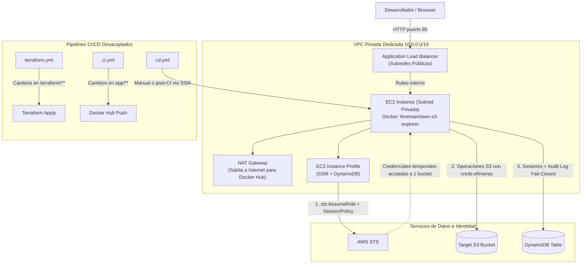

# S3 Explorer IDP — Ephemeral Just-In-Time Access Platform

**Internal Developer Platform (IDP)** web con arquitectura de **ALB Público + EC2 Privado (Docker)** que permite a los desarrolladores explorar buckets específicos de Amazon S3 mediante sesiones efímeras acotadas dinámicamente con **AWS STS Session Policies**, garantizando principio de mínimo privilegio (*Just-In-Time Access*), soporte para **Magic Links (`?session=UUID`)**, aprovisionamiento vía Webhook y **auditoría enriquecida Fail-Closed** en DynamoDB.

---

## 1. El Problema y la Solución

### El Problema
Otorgar acceso directo a la consola de AWS o credenciales estáticas de CLI para inspeccionar buckets durante un incidente o tarea de desarrollo rompe el principio de mínimo privilegio, expone otros buckets de la cuenta y deja poca trazabilidad sobre qué usuario consultó o modificó cada objeto. En sistemas legados donde se creaban stacks de CloudFormation por sesión, la creación tardaba minutos, se alcanzaban cuotas de stacks y frecuentemente quedaban roles huérfanos por fallas de borrado.

### La Solución
Un portal web de autoservicio accesible públicamente mediante ALB:
1. **Nada es permanente excepto los datos:** No se crean usuarios ni roles físicos por cada solicitud. Un **Session Broker** asume un único `BrokerRole` generando credenciales temporales STS recortadas en tiempo real mediante una **Session Policy en línea** válida exclusivamente para el bucket solicitado.
2. **Aprovisionamiento via Webhook y Magic Links:** El sistema puede recibir solicitudes (`POST /api/provision-session`) con `email`, `username`, `bucket_name`, `aws_account_id` y `duration_minutes`, devolviendo un **Magic Link** (`http://<ALB_DNS>/?session=<UUID>`) para acceder inmediatamente en el navegador sin login ni credenciales locales.
3. **Expiración matemática (Zero-Maintenance Cleanup):** Las credenciales temporales mueren automáticamente al vencer su duración (`DurationSeconds`) y los registros de sesión se purgan de forma nativa mediante **DynamoDB TTL**.
4. **Auditoría Fail-Closed Enriquecida:** Cada operación sobre S3 (`ListObjectsV2`, `GetObject`, `PutObject`) se audita registrando el correo, nombre de usuario, cuenta de AWS, acción y ruta del objeto en DynamoDB antes de responder al cliente.

---

## 2. Arquitectura del Sistema



### Decisiones Clave de Diseño (ADR)
* **ALB Público + EC2 Privado:** La instancia EC2 reside en una subred privada sin IP pública directa, protegida por un Security Group que solo acepta tráfico desde el Load Balancer. La salida a internet se realiza a través de un NAT Gateway para descargar imágenes de Docker Hub y conectar a las APIs de AWS.
* **Cero Credenciales en la Máquina del Dev:** El desarrollador accede directamente a la URL pública del ALB en su navegador. La identidad de la plataforma reside en el **IAM Instance Profile** de la EC2, que asume los roles temporales con STS.
* **Desacoplamiento Total de Pipelines:**
  * `terraform.yml`: Se ejecuta si cambia la infraestructura o manualmente.
  * `ci.yml`: Construye y sube la imagen Docker a Docker Hub (`feversani/aws-s3-explorer:latest`).
  * `cd.yml`: Despliega la última versión a la EC2 vía AWS SSM Run Command. Es independiente y puede dispararse manualmente en cualquier momento sin recompilar la app.

---

## 3. Estructura del Monorepo

```text
aws-s3-explorer/
├── terraform/                      # Infraestructura como Código
│   ├── networking.tf              # VPC, Subnets Públicas/Privadas, IGW, NAT Gateway
│   ├── alb.tf                     # Application Load Balancer, Listener, Target Group
│   ├── security-group.tf          # SGs separados para ALB y EC2
│   ├── ec2.tf                     # Instancia EC2 privada + user_data con Docker
│   ├── iam-ec2.tf                 # IAM Role e Instance Profile (SSM + DynamoDB)
│   ├── iam-broker.tf              # BrokerRole con techo S3 para asumir con Session Policy
│   ├── dynamodb.tf                # Tabla de sesiones y auditoría Fail-Closed + TTL
│   ├── s3-code.tf & s3-example.tf # Buckets de prueba y almacenamiento
│   └── outputs.tf                 # application_url (DNS del ALB) y datos de conexión
├── app/                           # Código de la Plataforma
│   ├── server.py                  # Servidor HTTP autónomo (REST API + Static UI)
│   ├── session_broker.py          # Session Broker STS con Session Policies y Cross-Account
│   ├── s3_service.py              # Operaciones S3 aisladas con credenciales efímeras
│   ├── audit_service.py           # Auditoría enriquecida (Email, Usuario, Cuenta)
│   └── static/
│       └── index.html             # Interfaz web responsiva con soporte para Magic Links
├── .github/workflows/
│   ├── terraform.yml              # Pipeline de Infraestructura (paths: terraform/**)
│   ├── ci.yml                     # Pipeline CI Docker Hub (paths: app/**, Dockerfile)
│   └── cd.yml                     # Pipeline CD a EC2 via AWS SSM (On Demand / Post-CI)
├── Dockerfile                     # Imagen Python 3.12-slim
├── requirements.txt               # Dependencias (boto3)
└── Makefile                       # Helpers para comandos locales y Docker
```

---

## 4. Despliegue y Uso

### 1. Aprovisionar la Infraestructura
```bash
make init
make plan
make apply
```
Terraform devolverá el output `application_url` con el DNS del ALB (ej: `http://fvrsn-sandbox-alb-123456789.us-east-1.elb.amazonaws.com`).

### 2. Aprovisionar una Sesión Efímera vía API / Webhook
Podés solicitar una sesión enviando un POST a `/api/provision-session`:
```bash
curl -X POST http://<ALB_DNS>/api/provision-session \
  -H "Content-Type: application/json" \
  -d '{
    "email": "dev@empresa.com",
    "username": "dfeversani",
    "bucket_name": "fvrsn-example-1-...",
    "aws_account_id": "",
    "duration_minutes": 30
  }'
```
Respuesta:
```json
{
  "status": "created",
  "session_id": "8f3b2a1c...",
  "magic_link": "http://<ALB_DNS>/?session=8f3b2a1c...",
  "target_bucket": "fvrsn-example-1-...",
  "email": "dev@empresa.com",
  "username": "dfeversani",
  "expires_at": 1795135200,
  "duration_minutes": 30
}
```

### 3. Acceso del Desarrollador
El desarrollador abre el `magic_link` en cualquier navegador. La plataforma:
* Valida la sesión automáticamente.
* Muestra el email, usuario, cuenta de AWS y el contador regresivo de la sesión STS.
* Permite explorar, descargar y subir archivos únicamente en el bucket autorizado.
* Audita cada clic con trazabilidad total en DynamoDB.
