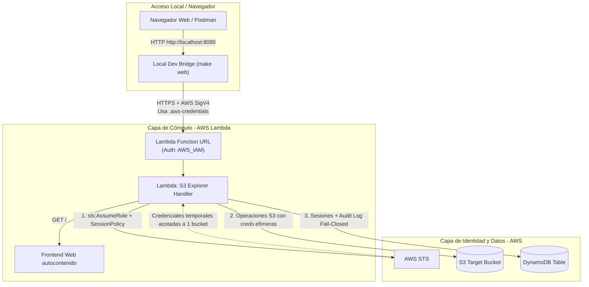

# S3 Explorer IDP — Ephemeral Just-In-Time Access Platform

**Internal Developer Platform (IDP)** web construido con arquitectura **100% Serverless** que permite a los desarrolladores explorar buckets específicos de Amazon S3 mediante sesiones efímeras acotadas dinámicamente con **AWS STS Session Policies**, garantizando principio de mínimo privilegio (*Just-In-Time Access*), limpieza automática por TTL y **auditoría Fail-Closed** en DynamoDB.

---

## 1. El Problema y la Solución

### El Problema
Otorgar acceso directo a la consola de AWS o credenciales estáticas de CLI para inspeccionar buckets durante un incidente o tarea de desarrollo rompe el principio de mínimo privilegio, expone otros buckets de la cuenta y deja poca trazabilidad a nivel de aplicación sobre qué objetos fueron consultados o modificados.

### La Solución
Un portal web de autoservicio donde:
1. **Nada es permanente excepto los datos:** No se crean usuarios ni roles físicos por cada solicitud. Un **Session Broker** asume un único `BrokerRole` generando credenciales temporales STS recortadas en tiempo real mediante una **Session Policy en línea** válida exclusivamente para el bucket solicitado.
2. **Expiración matemática (Zero-Maintenance Cleanup):** Las credenciales temporales mueren automáticamente al vencer su duración (`DurationSeconds`) y los registros de sesión se purgan de forma nativa mediante **DynamoDB TTL**.
3. **Auditoría Fail-Closed:** Cada operación sobre S3 (`ListObjectsV2`, `GetObject`, `PutObject`) se ejecuta exclusivamente con las credenciales acotadas de la sesión y registra la acción en DynamoDB antes de devolver respuesta al cliente.

---

## 2. Arquitectura del Sistema

El proyecto utiliza una arquitectura **Serverless Event-Driven** empaquetada en un monorepo donde conviven la infraestructura como código (`terraform/`) y la aplicación (`app/`).

### Topología Dual (Producción vs. Sandbox KodeKloud)

* **En Producción:** La Lambda se monta tras un API Gateway HTTP API v2 / CloudFront con autenticación perimetral (JWT/Cognito/OIDC) y acceso directo desde el navegador.
* **En Sandbox (KodeKloud):** Debido a las Service Control Policies (SCPs) que restringen endpoints públicos sin IAM, la Lambda expone una **Function URL con `authorization_type = "AWS_IAM"`**. Para interactuar con la UI web en el navegador, se utiliza un **Dev Bridge local** (`make web`) que firma las peticiones con SigV4 de forma transparente.



### Decisiones Clave de Diseño (ADR)
* **Serverless (Lambda) vs. EC2:** Se eligió AWS Lambda frente a una instancia EC2 para eliminar costos en reposo ($0 sin sesiones activas), reducir el *cold start* a milisegundos y evitar riesgos de *Instance Metadata Service (IMDS)* compartido entre múltiples sesiones web.
* **Cumplimiento de Restricciones Sandbox:** Implementación de `authorization_type = "AWS_IAM"` en la Function URL combinada con un puente local SigV4 sin dependencias para probar la experiencia web sin violar políticas perimetrales.
* **Desacoplamiento CI/CD (Infra vs. App):** Terraform aprovisiona la función Lambda con un paquete *placeholder* inicial (`archive_file`) y configura `lifecycle { ignore_changes = [filename, source_code_hash] }`. Las actualizaciones de código de la aplicación se despliegan en segundos mediante `make deploy-app` (`aws lambda update-function-code`) sin ensuciar ni bloquear el `tfstate`.

---

## 3. Estructura del Monorepo

```text
s3-explorer-idp/
├── infra/                      # Infraestructura como Código (Terraform)
│   ├── main.tf                 # S3 buckets (target + forbidden), DynamoDB (Single-Table + TTL)
│   ├── iam.tf                  # BrokerRole (techo S3) + LambdaExecRole (AssumeRole + DDB)
│   ├── compute.tf              # Lambda (placeholder + ignore_changes), API Gateway HTTP v2, SSM
│   └── outputs.tf              # URL del API, API Key autogenerada y nombres de recursos
├── app/                        # Código fuente de la plataforma (Python 3.12 / FastAPI)
│   ├── main.py                 # API REST, middleware de acceso web, Mangum handler y UI
│   ├── aws_clients.py          # Factory boto3 (soporta creds STS y modo AWS Emulator)
│   ├── session_broker.py       # Emisión de credenciales STS con SessionPolicy por bucket
│   ├── s3_service.py           # Cliente S3 aislado + registro de auditoría en DynamoDB
│   └── static/
│       └── index.html          # Interfaz web minimalista
├── tests/
│   └── test_e2e_sandbox.py     # Suite E2E: valida 401 sin key, 200 en target y 403 en forbidden
├── .github/workflows/
│   └── deploy.yml              # Pipeline CI/CD con Path Filtering (Emulator -> Sandbox)
├── requirements.txt
└── Makefile
```

---

## 4. Estrategia de Validación Híbrida (Sandbox + AWS Emulator)

El código soporta dos modos de ejecución mediante la variable de entorno `MODE`:

| Entorno | Modo | Qué valida | Tiempo / Costo |
| :--- | :--- | :--- | :--- |
| **AWS Sandbox Efímera** | `MODE=sandbox` | **Frontera real de seguridad IAM/STS.** Verifica que una sesión creada para `target-bucket` obtenga `200 OK` y que cualquier intento de acceder a `forbidden-bucket` sea bloqueado por AWS con `403 AccessDenied` y auditado en DynamoDB. | ~30s deploy / Efímero |
| **AWS Emulator (Rust)** | `MODE=emulator` | **Shift-Left Testing en local / CI.** Valida contratos de API Smithy, persistencia en DynamoDB y concurrencia multi-sesión 100% en memoria sin credenciales reales. | ~2s / $0 |

---

## 5. Guía Rápida de Despliegue (Sandbox Efímera)

### Prerrequisitos
* Terraform `>= 1.6`
* Python `3.12` y AWS CLI v2
* Credenciales activas (`AWS_ACCESS_KEY_ID`, `AWS_SECRET_ACCESS_KEY`) en tu terminal

### Pasos de ejecución

1. **Aprovisionar la infraestructura con Terraform:**
   ```bash
   make init
   make plan
   make apply
   ```

2. **Empaquetar y desplegar el código de la aplicación en Lambda:**
   ```bash
   make deploy-app
   ```

3. **Iniciar el Dev Bridge e interactuar con la interfaz web:**
   Inicia el proxy local que firma con SigV4:
   ```bash
   make web
   ```
   Abrí [http://localhost:8080](http://localhost:8080) en tu navegador para:
   * Solicitar una sesión efímera STS con Session Policy por bucket.
   * Explorar carpetas y descargar objetos.
   * Ejecutar la prueba de acceso cruzado (validar que AWS rechaza con `403 AccessDenied` cualquier bucket ajeno).
   * Ver los registros de auditoría en DynamoDB en tiempo real.

4. **Destruir los recursos antes de que expire la sandbox:**
   ```bash
   terraform -chdir=terraform destroy -auto-approve
   ```

---

## 6. Próximas Iteraciones (Roadmap)

* [ ] Descarga y subida directa de objetos pesados mediante **S3 Presigned URLs** firmadas con las credenciales STS de la sesión.
* [ ] Integración de `docker-compose.yml` con **AWS Emulator** para levantar el entorno completo en local sin conexión a internet.
* [ ] Reemplazo de `X-API-Key` por autenticación OIDC corporativa mediante **API Gateway JWT Authorizer**.