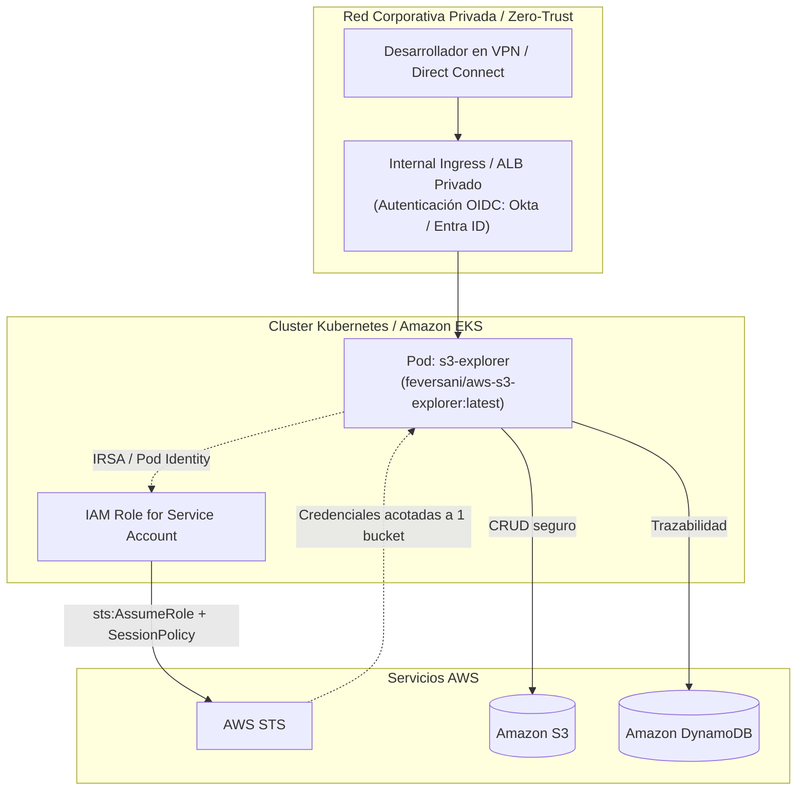
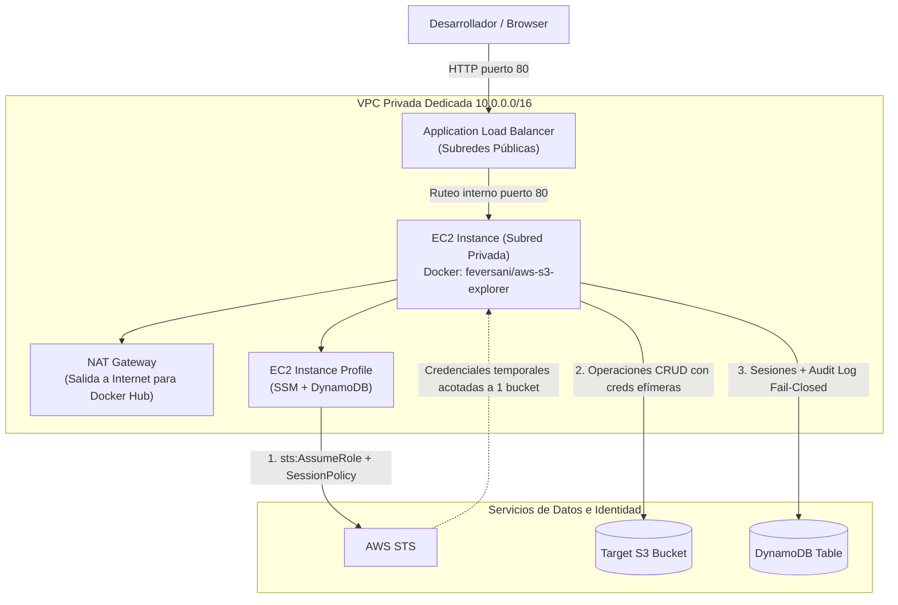
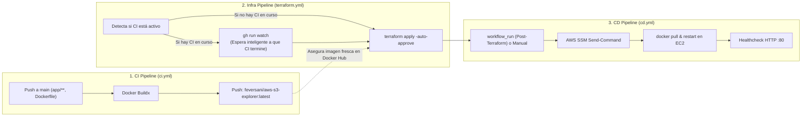
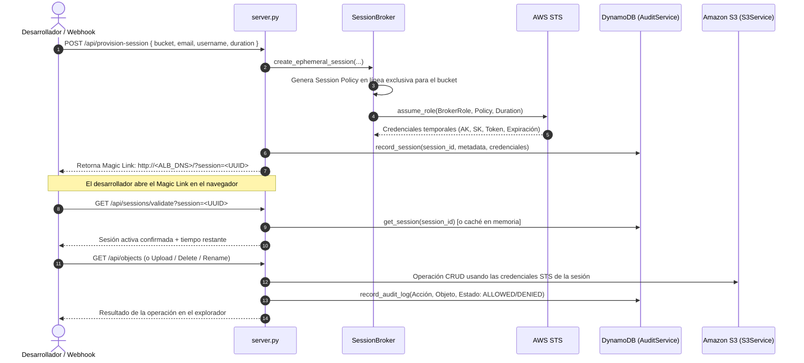

# AWS S3 Explorer IDP — Just-In-Time Developer Portal for Amazon S3 Buckets

**Internal Developer Platform (IDP)** web con arquitectura de **ALB Público + EC2 Privado (Docker)** que permite a los desarrolladores explorar buckets específicos de Amazon S3 mediante sesiones efímeras acotadas dinámicamente con **AWS STS Session Policies**, garantizando principio de mínimo privilegio (*Just-In-Time Access*), soporte para **Magic Links (`?session=UUID`)**, aprovisionamiento vía Webhook, operaciones **CRUD completas sobre S3** y **auditoría enriquecida Fail-Closed** en DynamoDB.

---

## 1. El Problema y la Solución

### El Problema
Otorgar acceso directo a la consola de AWS o credenciales estáticas de CLI para inspeccionar buckets durante un incidente o tarea de desarrollo rompe el principio de mínimo privilegio, expone otros buckets de la cuenta y deja poca trazabilidad sobre qué usuario consultó o modificó cada objeto. En sistemas legados donde se creaban stacks de CloudFormation por sesión, la creación tardaba minutos, se alcanzaban cuotas de stacks y frecuentemente quedaban roles huérfanos por fallas de borrado.

### La Solución
Un portal web de autoservicio accesible públicamente mediante ALB:
1. **Nada es permanente excepto los datos:** No se crean usuarios ni roles físicos por cada solicitud. Un **Session Broker** asume un único `BrokerRole` generando credenciales temporales STS recortadas en tiempo real mediante una **Session Policy en línea** válida exclusivamente para el bucket solicitado.
2. **Aprovisionamiento via Webhook y Magic Links:** El sistema recibe solicitudes (`POST /api/provision-session`) con `email`, `username`, `bucket_name`, `aws_account_id` y `duration_minutes`, devolviendo un **Magic Link** (`http://<ALB_DNS>/?session=<UUID>`) para acceder inmediatamente en el navegador sin login ni credenciales locales.
3. **Expiración matemática (Zero-Maintenance Cleanup):** Las credenciales temporales mueren automáticamente al vencer su duración (`DurationSeconds`) y los registros de sesión se purgan de forma nativa mediante **DynamoDB TTL**.
4. **Auditoría Fail-Closed Enriquecida:** Cada operación sobre S3 (`ListObjectsV2`, `GetObject`, `PutObject`, `DeleteObject`) se audita registrando el correo, nombre de usuario, cuenta de AWS, acción y ruta del objeto en DynamoDB antes de responder al cliente.

---

---

## 2. Alcance del Proyecto: PoC en Sandbox (KodeKloud) vs. Proyección a Producción

> [!IMPORTANT]
> **Este repositorio es una Prueba de Concepto (PoC) completa y funcional.** La arquitectura de infraestructura provista en la carpeta `terraform/` (ALB público + EC2 en subred privada + NAT Gateway) es una implementación de referencia adaptada a las restricciones de un **entorno sandbox efímero de KodeKloud**.
> 
> **Lo verdaderamente importante es la aplicación Docker (`feversani/aws-s3-explorer:latest`)**, la cual está desacoplada y diseñada para ser desplegada en **cualquier entorno corporativo** (Kubernetes, ECS Fargate, On-Premise) con la arquitectura que mejor se adapte a tu organización.

### 2.1. ¿Qué recursos mínimos de AWS necesita la aplicación para correr en tu entorno?

La aplicación en Docker no requiere infraestructura compleja; puede desplegarse en minutos si cuentas con estos tres componentes básicos en AWS:

1. **Identidad de Ejecución IAM (Identity Role):**
   * **En Kubernetes (EKS):** Un ServiceAccount con **IRSA (IAM Roles for Service Accounts)** o **EKS Pod Identity**.
   * **En AWS ECS:** Un **Task Role**.
   * **En EC2 / VMs:** Un **Instance Profile**.
   * *Permisos requeridos:*
     * `sts:AssumeRole` sobre el `BrokerRole`.
     * Permisos sobre DynamoDB (`dynamodb:PutItem`, `dynamodb:GetItem`, `dynamodb:Query`, `dynamodb:Scan`) sobre la tabla de sesiones.

2. **Broker Role (`BrokerRole`):**
   * Es el rol padre que posee el techo máximo de permisos sobre S3 (`AmazonS3FullAccess` o restringido a buckets de la empresa como `arn:aws:s3:::empresa-*`).
   * Posee una **Relación de Confianza (Trust Policy)** que autoriza a la *Identidad de Ejecución* a invocar `sts:AssumeRole`.
   * El Session Broker asume este rol inyectando la Session Policy en tiempo real.

3. **Tabla DynamoDB (Persistencia y Trazabilidad):**
   * Tabla con Partition Key `PK` (String) y Sort Key `SK` (String).
   * TTL nativo activado en el campo `expires_at` (opcional pero recomendado para auto-limpieza).

4. **Variables de entorno para el contenedor:**
   ```bash
   docker run -d -p 8080:8080 \
     -e BROKER_ROLE_ARN="arn:aws:iam::<ACCOUNT_ID>:role/mi-s3-broker" \
     -e DYNAMODB_TABLE="mi-tabla-auditoria" \
     -e AWS_REGION="us-east-1" \
     -e ENABLE_SANDBOX="false" \
     feversani/aws-s3-explorer:latest
   ```

---

### 2.2. Proyección hacia una Arquitectura Productiva Empresarial

En un entorno corporativo real, la arquitectura puede evolucionar según tus necesidades de seguridad y costos:



#### Modificaciones recomendadas para Producción:
* **Disponibilizar en un Pod de Kubernetes (EKS) con Load Balancer Interno:**
  * En lugar de aprovisionar un ALB público y una EC2 dedicada con NAT Gateway, desplegar la imagen en un `Deployment` / `Pod` dentro de un cluster de Kubernetes existente.
  * Exponer el servicio mediante un **Ingress con Load Balancer Interno (Private ALB)** accesible únicamente a través de la VPN corporativa, AWS Direct Connect o AWS PrivateLink.
  * Usar **IRSA (IAM Roles for Service Accounts)** o **EKS Pod Identity** para otorgar credenciales sin necesidad de secretos estáticos.
* **Arquitectura Efímera / Serverless (ECS Fargate a demanda):**
  * Desplegar la app como tareas efímeras de **AWS ECS Fargate** que escalan a cero cuando no hay desarrolladores conectados, reduciendo costos de cómputo inactivo.
* **Autenticación Empresarial (SSO / OIDC):**
  * Integrar autenticación a nivel del ALB Interno o Ingress Controller con el proveedor de identidad de la empresa (**Okta, Microsoft Entra ID / Azure AD, Keycloak o Google Workspace**) para validar qué usuarios pueden solicitar accesos JIT antes de abrir el portal.
* **Modo Producción Forzado:**
  * Definir `-e ENABLE_SANDBOX=false` para que la interfaz web opere exclusivamente mediante Magic Links generados por aprobaciones de Jira, Slack Bots o flujos autorizados.

---

## 3. Arquitectura de Referencia de la PoC (Sandbox KodeKloud)

A continuación se presenta el diagrama de arquitectura en tiempo de ejecución desplegado por Terraform en el entorno sandbox:



### Decisiones Clave de Diseño (ADRs adoptados para la Sandbox de KodeKloud)

Las decisiones de infraestructura implementadas en `terraform/` fueron seleccionadas expresamente para operar dentro de las limitaciones técnicas de una **sandbox efímera de KodeKloud**:

1. **¿Por qué ALB Público en lugar de Ingress Privado?**
   * *Restricción de la Sandbox:* En un entorno sandbox no existe una red corporativa privada, túnel VPN ni AWS Direct Connect conectado a la máquina del alumno.
   * *Decisión:* Se aprovisiona un Application Load Balancer público en subredes públicas con Internet Gateway, permitiendo que el desarrollador interactúe directamente desde su navegador web sin requerir configuraciones de red complejas.
   * *En Producción:* El ALB o Ingress Controller debe ser estrictamente interno, accesible únicamente mediante VPN corporativa o AWS PrivateLink.

2. **¿Por qué EC2 `t3.micro` en Subred Privada + Docker en vez de Kubernetes (EKS)?**
   * *Restricción de la Sandbox:* Las sesiones de KodeKloud tienen un tiempo de vida corto (1 a 3 horas) y cuotas ajustadas de cómputo y costos. Levantar un cluster de Amazon EKS toma entre 15 y 20 minutos, consume gran parte del crédito de la sandbox y añade complejidad innecesaria para validar el concepto.
   * *Decisión:* Una instancia EC2 `t3.micro` con Ubuntu y Docker se aprovisiona y queda lista en menos de 60 segundos mediante `user_data`, manteniendo el cómputo seguro en una subred privada sin IP pública directa y aceptando tráfico exclusivamente desde el Security Group del ALB.

3. **¿Por qué NAT Gateway en lugar de VPC Endpoints?**
   * *Restricción de la Sandbox:* La instancia EC2 en subred privada necesita salida a internet para descargar la imagen Docker desde Docker Hub (`feversani/aws-s3-explorer:latest`) y comunicarse con las APIs públicas de AWS (STS, DynamoDB, Systems Manager).
   * *Decisión:* Un NAT Gateway único en la subred pública provee salida outbound para la EC2. En un entorno productivo de larga duración, se recomienda reemplazar o complementar el NAT Gateway con **AWS VPC Endpoints (Gateway Endpoint para S3 y DynamoDB sin costo de transferencia, e Interface Endpoints para STS/SSM vía AWS PrivateLink)**.

4. **¿Por qué AWS Systems Manager (SSM) en lugar de SSH?**
   * *Decisión:* No se generan pares de llaves SSH (`.pem`) ni se abre el puerto 22 en los Security Groups. Toda la gestión remota, verificación de estado y despliegues continuos (CD) se realizan a través del agente de AWS Systems Manager (SSM), garantizando acceso autenticado por IAM y trazabilidad en CloudTrail.

5. **Restricción de IAM en Sandbox (Bloqueo de Service Control Policies - SCP):**
   * *Restricción de la Sandbox:* Las sandbox de laboratorio aplican SCPs estrictas que prohíben la creación y modificación de políticas en línea (`iam:PutRolePolicy`).
   * *Decisión:* La infraestructura Terraform utiliza exclusivamente **AWS Managed Policies** (`AmazonS3FullAccess`, `AmazonDynamoDBFullAccess`, `AmazonSSMManagedInstanceCore`) atadas mediante `aws_iam_role_policy_attachment`. La delimitación estricta de seguridad al bucket específico **no se hace en el rol estático**, sino en tiempo de ejecución mediante la **Session Policy en línea de AWS STS**, la cual sí está permitida por las SCPs.

---

## 4. Arquitectura Multi-Cuenta Empresarial (Cross-Account Architecture)

En organizaciones con múltiples cuentas de AWS (arquitectura Hub & Spoke / AWS Organizations), el portal **AWS S3 Explorer IDP** escala de manera transparente sin necesidad de replicar la aplicación en cada cuenta ni gestionar credenciales en silos.

```mermaid
flowchart TB
    subgraph Hub_Account ["Cuenta Central / IDP (Tooling Account: 000000000000)"]
        User[Desarrollador / Navegador Web] -->|1. Magic Link / Single Sign-On| Ingress["Ingress / ALB Privado"]
        Ingress --> App["Pod / Contenedor: S3 Explorer IDP<br>(feversani/aws-s3-explorer)"]
        App -.->|Identidad de Plataforma| PlatformRole["PlatformIdentityRole"]
        App -->|Trazabilidad Centralizada Fail-Closed| DDB[("DynamoDB Central<br>(Auditoría Global & Sesiones)")]
    end

    subgraph Spoke_Dev ["Cuenta Workload Dev (111111111111)"]
        RoleDev["IAM Broker Role Dev<br>(Trust: PlatformIdentityRole)"]
        S3Dev[("Buckets S3 Dev")]
    end

    subgraph Spoke_Prod ["Cuenta Workload Prod (222222222222)"]
        RoleProd["IAM Broker Role Prod<br>(Trust: PlatformIdentityRole)"]
        S3Prod[("Buckets S3 Prod")]
    end

    subgraph Spoke_DataLake ["Cuenta Data Lake / Analytics (333333333333)"]
        RoleData["IAM Broker Role Analytics<br>(Trust: PlatformIdentityRole)"]
        S3Data[("Buckets S3 Data Lake")]
    end

    PlatformRole ==="2. sts:AssumeRole + SessionPolicy"===> RoleDev
    PlatformRole ==="2. sts:AssumeRole + SessionPolicy"===> RoleProd
    PlatformRole ==="2. sts:AssumeRole + SessionPolicy"===> RoleData

    App -.->|"3. CRUD Efímero (15 min)"| S3Dev
    App -.->|"3. CRUD Efímero (15 min)"| S3Prod
    App -.->|"3. CRUD Efímero (15 min)"| S3Data
```

### ¿Cómo opera el modelo Cross-Account?

1. **Cuenta Central / Tooling (Hub Account):**
   * Aloja la aplicación (desplegada en Kubernetes EKS o ECS Fargate) bajo un único rol de IAM (`PlatformIdentityRole`).
   * Contiene la **tabla centralizada de DynamoDB**. Toda la trazabilidad de auditoría de todas las cuentas y unidades de negocio de la empresa converge en esta tabla única, facilitando auditorías de cumplimiento (SOX, ISO 27001, PCI-DSS).
2. **Cuentas de Carga de Trabajo (Spoke / Workload Accounts):**
   * No requieren servidores ni software adicional.
   * Solo necesitan un rol IAM (`arn:aws:iam::<TARGET_ACCOUNT_ID>:role/fvrsn-sandbox-s3-broker`) cuya política de confianza (**Trust Policy**) autoriza únicamente al `PlatformIdentityRole` de la Cuenta Central a ejecutar `sts:AssumeRole`:
     ```json
     {
       "Effect": "Allow",
       "Principal": {
         "AWS": "arn:aws:iam::000000000000:role/PlatformIdentityRole"
       },
       "Action": "sts:AssumeRole"
     }
     ```
3. **Flujo de Acceso:**
   * Al solicitar una sesión indicando la cuenta destino (`aws_account_id: "222222222222"`):
   * El `SessionBroker` asume el rol remoto inyectando la Session Policy dinámica acotada exclusivamente al bucket de esa cuenta.
   * El cliente realiza las operaciones CRUD sobre el bucket remoto usando las credenciales temporales generadas.
   * Cada acción queda registrada de inmediato en la tabla central de DynamoDB con el campo `aws_account_id` correspondiente.

---

## 5. Cadena de Despliegue CI/CD Secuencial e Inteligente

El ciclo de vida del código y la infraestructura está completamente automatizado a través de GitHub Actions, desacoplando la integración continua de la aplicación del aprovisionamiento de infraestructura:



### Sincronización Automática e Inteligente:
* **`ci.yml` (1ero en la cadena si aplica):** Se dispara únicamente ante cambios en `app/**` o `Dockerfile`. Compila y publica la imagen multiplataforma en Docker Hub.
* **`terraform.yml` (2do en la cadena):** 
  * Se dispara ante cambios en `terraform/**` o `app/**`.
  * **Mecanismo de espera inteligente:** Ejecuta un script con `gh run watch` que detecta si el pipeline de CI se está ejecutando para el mismo commit SHA. Si es así, espera pacientemente a que la nueva imagen de Docker esté disponible en Docker Hub antes de tocar la infraestructura.
  * Si el commit solo involucra archivos de infraestructura (`terraform/**`), el CI no se activa y Terraform procede **inmediatamente sin esperas innecesarias**.
* **`cd.yml` (3ero en la cadena):** Se dispara automáticamente tras finalizar Terraform exitosamente, o puede ejecutarse manualmente (`workflow_dispatch`) en cualquier momento. Se conecta a la EC2 privada vía **AWS SSM** para descargar la última imagen y reiniciar el contenedor inyectando dinámicamente las variables de entorno de `BROKER_ROLE_ARN` y `DYNAMODB_TABLE`.

---

## 6. Modo Sandbox vs Modo Producción

El portal permite habilitar o deshabilitar las opciones de prueba dummy en la página principal mediante la variable de entorno **`ENABLE_SANDBOX`**:

| Variable | Valor | Comportamiento en la UI |
| :--- | :--- | :--- |
| `ENABLE_SANDBOX` | `true` *(default)* | Muestra el acordeón *"⚙️ Aprovisionar Sesión de Prueba (POST Dummy)"* en la página de inicio para generar accesos rápidos de desarrollo. |
| `ENABLE_SANDBOX` | `false` | **Modo Producción:** Oculta por completo la sección de prueba del DOM. La pantalla de bienvenida solo muestra el campo limpio para ingresar con un Magic Link o Session ID legítimo. |

### Configuración:
* **En Dockerfile:** Viene activado por defecto con `ENV ENABLE_SANDBOX=true`.
* **Al correr el contenedor:** Se puede deshabilitar con `-e ENABLE_SANDBOX=false`:
  ```bash
  docker run -d -p 80:8080 -e ENABLE_SANDBOX=false feversani/aws-s3-explorer:latest
  ```

---

## 7. Experiencia de Usuario y Operaciones CRUD en S3

### A. Página Principal (Sin sesión activa)
* Vista minimalista sin tablas de explorador ni registros vacíos.
* Campo de acceso directo: *"Ingresá con tu Magic Link o Session ID"*.
* Sección opcional de prueba (si `ENABLE_SANDBOX=true`) para generar una sesión efímera instantánea.

### B. Vista de Sesión Activa (Con Magic Link `?session=UUID`)
* **Banner de Sesión:** Muestra Bucket asignado, Usuario, Correo, Cuenta AWS, contador regresivo en vivo de la sesión STS y el botón **`📋 Auditoría de la Sesión`**.
* **Explorador de Archivos con Drag & Drop, Búsqueda y Paginación:**
  * 📂 **Drag & Drop desde la PC:** Arrastrá y soltá uno o varios archivos directamente sobre la pantalla para subirlos automáticamente a S3 en la carpeta actual (soporta texto y binarios en Base64).
  * 📤 **Subir desde PC:** Selector tradicional de archivos locales del sistema operativo.
  * 🔍 **Búsqueda en tiempo real:** Barra de filtrado instantáneo por nombre de archivo o carpeta.
  * 📄 **Paginación:** Configurable en 10, 25 o 50 items por página con navegación anterior/siguiente.
  * ➕ **Nuevo Archivo / Nueva Carpeta:** Creación manual con modal.
  * 👁️ **Ver:** Visor modal de contenido de texto.
  * 📥 **Descargar:** Descarga directa del archivo a la PC local (`Content-Disposition: attachment`).
  * ✏️ **Renombrar:** Modal para renombrar archivos directamente en S3 (`CopyObject` + `DeleteObject`).
  * 🗑️ **Eliminar:** Diálogo de confirmación y borrado en S3 (`s3:DeleteObject`).
  * 🧪 **Test 403:** Prueba la frontera de seguridad intentando acceder a otro bucket ajeno y verifica el rechazo de AWS STS.
* **Modal Dedicado de Auditoría de la Sesión (`📋 Auditoría de la Sesión`):**
  * Consulta en DynamoDB filtrada específicamente por el Partition Key `SESSION#<session_id>`.
  * Filtro por texto y estado (`ALLOWED` / `DENIED`).
  * Paginación integrada de eventos de auditoría.

---

## 8. Funcionamiento Interno del Código Fuente

A continuación se detalla cómo interactúan los módulos de la aplicación en `app/`, cómo se crean y persisten las sesiones, cómo funcionan los **Magic Links** y cómo opera la seguridad a bajo nivel.

### 8.1. Ciclo de Vida de una Sesión y Magic Link



---

### 8.2. Módulos de la Aplicación (`app/`)

#### 1. `app/server.py` (Controlador HTTP Autónomo)
* **Arquitectura:** Servidor HTTP nativo en Python (`http.server.BaseHTTPRequestHandler`) sin dependencias de frameworks externos pesados (como Flask o FastAPI), manteniendo la imagen de Docker extremadamente ligera (<120MB).
* **Mapeo de Rutas REST:**
  * `GET /`: Sirve la Single Page Application (SPA) [static/index.html](file:///Users/diegofeversani/Documents/fvrsn/feversani-labs/aws-s3-explorer/app/static/index.html).
  * `GET /api/info`: Devuelve el estado de la plataforma, si el modo Sandbox está habilitado (`ENABLE_SANDBOX`), y el Account ID actual.
  * `POST /api/provision-session`: Endpoint de aprovisionamiento invocado por Webhooks o pruebas.
  * `GET /api/sessions/validate`: Valida si un Magic Link es legítimo y calcula los segundos restantes.
  * `GET /api/objects`: Lista los objetos y carpetas del bucket (`s3:ListBucket`).
  * `GET /api/objects/content`: Lee el contenido o descarga directamente el archivo a la PC (`download=true`).
  * `POST /api/objects/upload`: Crea o actualiza archivos en S3 (`s3:PutObject`), con soporte para texto y binarios en Base64.
  * `POST /api/objects/rename`: Renombra objetos en S3 (`s3:CopyObject` + `s3:DeleteObject`).
  * `POST /api/objects/delete`: Elimina archivos en S3 (`s3:DeleteObject`).
  * `GET /api/audits?session_id=<UUID>`: Devuelve los logs de auditoría exclusivos de esa sesión.
  * `POST /api/test-forbidden`: Verifica la frontera de seguridad forzando una llamada a un bucket no autorizado.

#### 2. `app/session_broker.py` (Generador de Credenciales STS Just-In-Time)
* **Principio de Mínimo Privilegio Dinámico:** El broker no asigna políticas preexistentes. Genera una **Session Policy en tiempo real** en formato JSON que acota los permisos del rol padre (`BrokerRole`) al bucket exacto solicitado:
  * `s3:ListBucket` restringido a `arn:aws:s3:::<bucket_name>`.
  * `s3:GetObject`, `s3:PutObject`, `s3:DeleteObject` restringidos a `arn:aws:s3:::<bucket_name>/*`.
* **Soporte Cross-Account:** Si se especifica `aws_account_id`, asume el rol de destino en la cuenta remota (`arn:aws:iam::<account_id>:role/fvrsn-sandbox-s3-broker`).
* **Auto-discovery Resiliente:** Si la variable de entorno `BROKER_ROLE_ARN` no fue inyectada al contenedor, el broker consulta automáticamente la cuenta actual mediante `sts:GetCallerIdentity` y construye el ARN del rol sin fallar.

#### 3. `app/audit_service.py` (Persistencia y Trazabilidad Fail-Closed)
* **¿Dónde se guardan las sesiones?**
  1. **Caché en Memoria Local (`ACTIVE_SESSIONS` en `server.py`):** Brinda respuestas en sub-milisegundos mientras el contenedor está en ejecución.
  2. **Persistencia en DynamoDB (`fvrsn-sandbox-s3-explorer-idp`):** Cada sesión se almacena con la clave primaria `PK = SESSION#<session_id>` y `SK = METADATA`. Si el contenedor se reinicia o se escala horizontalmente detrás del Load Balancer, cualquier réplica puede recuperar y validar la sesión inmediatamente.
  3. **Purga Automática (Zero-Maintenance TTL):** El atributo `expires_at` contiene el epoch timestamp de vencimiento. DynamoDB utiliza su motor de TTL nativo para eliminar automáticamente los registros vencidos sin necesidad de cronjobs ni lambdas de limpieza.
* **Trazabilidad por Sesión:** Cada acción del usuario se guarda con `PK = SESSION#<session_id>` y `SK = AUDIT#<timestamp>#<action>`. Esto permite consultar los logs de una sesión específica con una **Query DynamoDB de costo mínimo** sin necesidad de escanear la tabla completa.

#### 4. `app/s3_service.py` (Capa de Operaciones S3)
* **Aislamiento Criptográfico:** Nunca utiliza credenciales de administrador ni las credenciales de la instancia EC2 para interactuar con los datos. Instancia un cliente de `boto3.client('s3')` inyectando únicamente las credenciales efímeras (`access_key_id`, `secret_access_key`, `session_token`) de la sesión validada.
* **Auditoría Fail-Closed:** Si ocurre un error al registrar la acción en DynamoDB, la operación se interrumpe inmediatamente para garantizar que ninguna lectura o escritura ocurra sin registro auditable.

#### 5. `app/static/index.html` (Single Page Application Web)
* **Acceso por Magic Link:** Al ingresar con `?session=<UUID>`, el cliente extrae el token de la URL, lo valida contra el servidor y renderiza la vista de sesión.
* **Contador Regresivo en Vivo:** Un timer en JavaScript calcula segundo a segundo el tiempo restante contra `expires_at`. Al expirar, deshabilita las operaciones y notifica al usuario.
* **Operaciones CRUD y Drag & Drop:** Maneja subidas por arrastre (`FileReader`), visor de documentos de texto, modales de renombrado y eliminación.

---

## 9. Estructura del Proyecto

```text
aws-s3-explorer/
├── terraform/                      # Infraestructura como Código
│   ├── networking.tf              # VPC, Subnets Públicas/Privadas, IGW, NAT Gateway
│   ├── alb.tf                     # Application Load Balancer, Listener, Target Group
│   ├── security-group.tf          # SGs separados para ALB y EC2
│   ├── ec2.tf                     # Instancia EC2 privada + user_data con Docker
│   ├── iam-ec2.tf                 # IAM Role e Instance Profile (SSM + DynamoDB)
│   ├── iam-broker.tf              # BrokerRole con techo S3 para asumir con Session Policy
│   ├── dynamodb.tf                # Tabla de sesiones y auditoría Fail-Closed + TTL
│   ├── s3-code.tf & s3-example.tf # Buckets de prueba y almacenamiento
│   └── outputs.tf                 # application_url (DNS del ALB) y datos de conexión
├── app/                           # Código de la Plataforma
│   ├── server.py                  # Servidor HTTP autónomo (REST API CRUD + Static UI)
│   ├── session_broker.py          # Session Broker STS con Session Policies y Auto-discovery
│   ├── s3_service.py              # Operaciones S3 CRUD aisladas con credenciales efímeras
│   ├── audit_service.py           # Auditoría enriquecida (Email, Usuario, Cuenta)
│   └── static/
│       └── index.html             # Interfaz web responsiva con explorador CRUD y Magic Links
├── .github/workflows/
│   ├── ci.yml                     # 1. CI Docker Hub (paths: app/**, Dockerfile)
│   ├── terraform.yml              # 2. Terraform Deploy (Espera a CI si está activo)
│   └── cd.yml                     # 3. CD a EC2 via AWS SSM (Post-Terraform o Manual)
├── scripts/
│   ├── test_post.sh               # Envía POST de aprovisionamiento detectando el ALB
│   └── restart_container.sh       # Reinicia el contenedor en EC2 inyectando variables por SSM
├── env.sh                         # Carga credenciales efímeras en la terminal actual
├── Dockerfile                     # Imagen Python 3.12-slim con ENABLE_SANDBOX=true
├── requirements.txt               # Dependencias (boto3)
└── Makefile                       # Helpers para desarrollo, infra y despliegues
```

---

## 10. Comandos Locales y Helpers (`Makefile`)

### Configurar perfil AWS en tu terminal:
```bash
source env.sh
# Podés tirar comandos nativos de AWS CLI usando el perfil efímero:
aws s3 ls
aws s3 ls s3://tu-bucket/
```
O directamente con `make`:
```bash
make s3-ls
make s3-ls BUCKET=s3://nombre-de-bucket
```

### Probar el POST dummy contra el Load Balancer:
El script detecta automáticamente el DNS del ALB desde los outputs de Terraform o AWS CLI:
```bash
# Ejecución con detección automática:
make test-post

# O especificando parámetros por variable de entorno:
ALB_URL="http://mi-alb-dns.elb.amazonaws.com" \
BUCKET="mi-bucket-personalizado" \
USERNAME="dfeversani" \
EMAIL="dev@feversani.internal" \
DURATION_MINUTES=30 \
./scripts/test_post.sh
```

### Reiniciar el contenedor en EC2 vía AWS SSM:
Si actualizás variables de entorno o la imagen de Docker y querés reiniciar la EC2 inmediatamente sin pasar por GitHub Actions:
```bash
make restart-container
```
