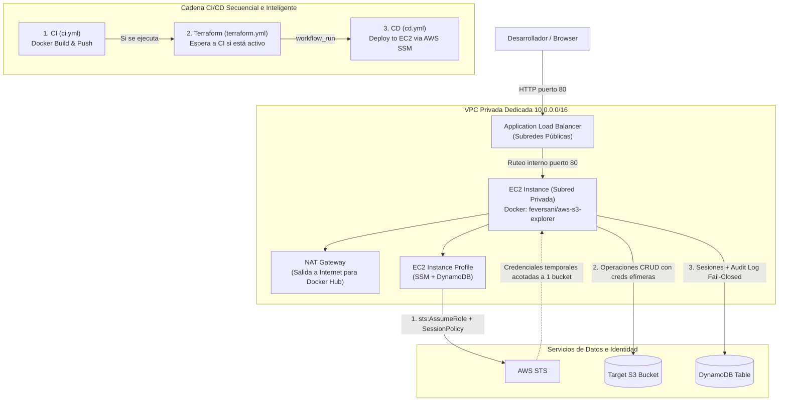

# AWS S3 Explorer IDP — Just-In-Time Developer Portal for Amazon S3 Buckets

**Internal Developer Platform (IDP)** web con arquitectura de **ALB Público + EC2 Privado (Docker)** que permite a los desarrolladores explorar buckets específicos de Amazon S3 mediante sesiones efímeras acotadas dinámicamente con **AWS STS Session Policies**, garantizando principio de mínimo privilegio (*Just-In-Time Access*), soporte para **Magic Links (`?session=UUID`)**, aprovisionamiento vía Webhook, operaciones **CRUD completas sobre S3** y **auditoría enriquecida Fail-Closed** en DynamoDB.

---

## 1. El Problema y la Solución

### El Problema
Otorgar acceso directo a la consola de AWS o credenciales estáticas de CLI para inspeccionar buckets durante un incidente o tarea de desarrollo rompe el principio de mínimo privilegio, expone otros buckets de la cuenta y deja poca trazabilidad sobre qué usuario consultó o modificó cada objeto. En sistemas legados donde se creaban stacks de CloudFormation por sesión, la creación tardaba minutos, se alcanzaban cuotas de stacks y frecuentemente quedaban roles huérfanos por fallas de borrado.

### La Solución
Un portal web de autoservicio accesible públicamente mediante ALB:
1. **Nada es permanente excepto los datos:** No se crean usuarios ni roles físicos por cada solicitud. Un **Session Broker** asume un único `BrokerRole` generando credenciales temporales STS recortadas en tiempo real mediante una **Session Policy en línea** válida exclusivamente para el bucket solicitado.
2. **Aprovisionamiento via Webhook y Magic Links:** El sistema recibe solicitudes (`POST /api/provision-session`) con `email`, `username`, `bucket_name`, `aws_account_id` y `duration_minutes`, devolviendo un **Magic Link** (`http://<ALB_DNS>/?session=<UUID>`) para acceder inmediatamente en el navegador sin login ni credenciales locales.
3. **Expiración matemática (Zero-Maintenance Cleanup):** Las credenciales temporales mueren automáticamente al vencer su duración (`DurationSeconds`) y los registros de sesión se purgan de forma nativa mediante **DynamoDB TTL**.
4. **Auditoría Fail-Closed Enriquecida:** Cada operación sobre S3 (`ListObjectsV2`, `GetObject`, `PutObject`, `DeleteObject`) se audita registrando el correo, nombre de usuario, cuenta de AWS, acción y ruta del objeto en DynamoDB antes de responder al cliente.

---

## 2. Arquitectura del Sistema



### Decisiones Clave de Diseño (ADR)
* **ALB Público + EC2 Privado:** La instancia EC2 reside en una subred privada sin IP pública directa, protegida por un Security Group que solo acepta tráfico desde el Load Balancer. La salida a internet se realiza a través de un NAT Gateway para descargar imágenes de Docker Hub y conectar a las APIs de AWS.
* **Cero Credenciales en la Máquina del Dev:** El desarrollador accede directamente a la URL pública del ALB en su navegador. La identidad de la plataforma reside en el **IAM Instance Profile** de la EC2, que asume los roles temporales con STS.
* **Cadena de Despliegue Secuencial e Inteligente (`CI -> Terraform -> CD`):**
  * `ci.yml`: 1ero en la cadena (si aplica). Construye y sube la imagen Docker a Docker Hub (`feversani/aws-s3-explorer:latest`).
  * `terraform.yml`: 2do en la cadena. **Sincronización automática:** Si hay un CI corriendo para el commit actual, **espera a que termine** usando `gh run watch`. Si el CI no se disparó (ej: cambio exclusivo en `terraform/**`), **se ejecuta de inmediato** sin esperas.
  * `cd.yml`: 3ero en la cadena. Se ejecuta automáticamente tras finalizar Terraform, o de forma manual e independiente (`workflow_dispatch`) en cualquier momento para desplegar la última imagen a la EC2 vía AWS SSM.

---

## 3. Modo Sandbox vs Modo Producción

El portal permite habilitar o deshabilitar las opciones de prueba dummy en la página principal mediante la variable de entorno **`ENABLE_SANDBOX`**:

| Variable | Valor | Comportamiento en la UI |
| :--- | :--- | :--- |
| `ENABLE_SANDBOX` | `true` *(default)* | Muestra el acordeón *"⚙️ Aprovisionar Sesión de Prueba (POST Dummy)"* en la página de inicio para generar accesos rápidos de desarrollo. |
| `ENABLE_SANDBOX` | `false` | **Modo Producción:** Oculta por completo la sección de prueba del DOM. La pantalla de bienvenida solo muestra el campo limpio para ingresar con un Magic Link o Session ID legítimo. |

### Configuración:
* **En Dockerfile:** Viene activado por defecto con `ENV ENABLE_SANDBOX=true`.
* **Al correr el contenedor:** Se puede deshabilitar con `-e ENABLE_SANDBOX=false`:
  ```bash
  docker run -d -p 80:8080 -e ENABLE_SANDBOX=false feversani/aws-s3-explorer:latest
  ```

---

## 4. Experiencia de Usuario y Operaciones CRUD en S3

### A. Página Principal (Sin sesión activa)
* Vista minimalista sin tablas de explorador ni registros vacíos.
* Campo de acceso directo: *"Ingresá con tu Magic Link o Session ID"*.
* Sección opcional de prueba (si `ENABLE_SANDBOX=true`) para generar una sesión efímera instantánea.

### B. Vista de Sesión Activa (Con Magic Link `?session=UUID`)
* **Banner de Sesión:** Muestra Bucket asignado, Usuario, Correo, Cuenta AWS, contador regresivo en vivo de la sesión STS y el botón **`📋 Auditoría de la Sesión`**.
* **Explorador de Archivos con Drag & Drop, Búsqueda y Paginación:**
  * 📂 **Drag & Drop desde la PC:** Arrastrá y soltá uno o varios archivos directamente sobre la pantalla para subirlos automáticamente a S3 en la carpeta actual (soporta texto y binarios en Base64).
  * 📤 **Subir desde PC:** Selector tradicional de archivos locales del sistema operativo.
  * 🔍 **Búsqueda en tiempo real:** Barra de filtrado instantáneo por nombre de archivo o carpeta.
  * 📄 **Paginación:** Configurable en 10, 25 o 50 items por página con navegación anterior/siguiente.
  * ➕ **Nuevo Archivo / Nueva Carpeta:** Creación manual con modal.
  * 👁️ **Ver:** Visor modal de contenido de texto.
  * 📥 **Descargar:** Descarga directa del archivo a la PC local (`Content-Disposition: attachment`).
  * ✏️ **Editar:** Editor interactivo para modificar el contenido y guardarlo en S3 (`s3:PutObject`).
  * 🗑️ **Eliminar:** Diálogo de confirmación y borrado en S3 (`s3:DeleteObject`).
  * 🧪 **Test 403:** Prueba la frontera de seguridad intentando acceder a otro bucket ajeno y verifica el rechazo de AWS STS.
* **Modal Dedicado de Auditoría de la Sesión (`📋 Auditoría de la Sesión`):**
  * Consulta en DynamoDB filtrada específicamente por el Partition Key `SESSION#<session_id>`.
  * Filtro por texto y estado (`ALLOWED` / `DENIED`).
  * Paginación integrada de eventos de auditoría.

---

## 5. Estructura del Proyecto

```text
aws-s3-explorer/
├── terraform/                      # Infraestructura como Código
│   ├── networking.tf              # VPC, Subnets Públicas/Privadas, IGW, NAT Gateway
│   ├── alb.tf                     # Application Load Balancer, Listener, Target Group
│   ├── security-group.tf          # SGs separados para ALB y EC2
│   ├── ec2.tf                     # Instancia EC2 privada + user_data con Docker
│   ├── iam-ec2.tf                 # IAM Role e Instance Profile (SSM + DynamoDB)
│   ├── iam-broker.tf              # BrokerRole con techo S3 para asumir con Session Policy
│   ├── dynamodb.tf                # Tabla de sesiones y auditoría Fail-Closed + TTL
│   ├── s3-code.tf & s3-example.tf # Buckets de prueba y almacenamiento
│   └── outputs.tf                 # application_url (DNS del ALB) y datos de conexión
├── app/                           # Código de la Plataforma
│   ├── server.py                  # Servidor HTTP autónomo (REST API CRUD + Static UI)
│   ├── session_broker.py          # Session Broker STS con Session Policies y Auto-discovery
│   ├── s3_service.py              # Operaciones S3 CRUD aisladas con credenciales efímeras
│   ├── audit_service.py           # Auditoría enriquecida (Email, Usuario, Cuenta)
│   └── static/
│       └── index.html             # Interfaz web responsiva con explorador CRUD y Magic Links
├── .github/workflows/
│   ├── ci.yml                     # 1. CI Docker Hub (paths: app/**, Dockerfile)
│   ├── terraform.yml              # 2. Terraform Deploy (Espera a CI si está activo)
│   └── cd.yml                     # 3. CD a EC2 via AWS SSM (Post-Terraform o Manual)
├── scripts/
│   ├── test_post.sh               # Envía POST de aprovisionamiento detectando el ALB
│   └── restart_container.sh       # Reinicia el contenedor en EC2 inyectando variables por SSM
├── env.sh                         # Carga credenciales efímeras en la terminal actual
├── Dockerfile                     # Imagen Python 3.12-slim con ENABLE_SANDBOX=true
├── requirements.txt               # Dependencias (boto3)
└── Makefile                       # Helpers para desarrollo, infra y despliegues
```

---

## 6. Comandos Locales y Helpers (`Makefile`)

### Configurar perfil AWS en tu terminal:
```bash
source env.sh
# Podés tirar comandos nativos de AWS CLI usando el perfil efímero:
aws s3 ls
aws s3 ls s3://tu-bucket/
```
O directamente con `make`:
```bash
make s3-ls
make s3-ls BUCKET=s3://nombre-de-bucket
```

### Probar el POST dummy contra el Load Balancer:
El script detecta automáticamente el DNS del ALB desde los outputs de Terraform o AWS CLI:
```bash
# Ejecución con detección automática:
make test-post

# O especificando parámetros por variable de entorno:
ALB_URL="http://mi-alb-dns.elb.amazonaws.com" \
BUCKET="mi-bucket-personalizado" \
USERNAME="dfeversani" \
EMAIL="dev@feversani.internal" \
DURATION_MINUTES=30 \
./scripts/test_post.sh
```

### Reiniciar el contenedor en EC2 vía AWS SSM:
Si actualizás variables de entorno o la imagen de Docker y querés reiniciar la EC2 inmediatamente sin pasar por GitHub Actions:
```bash
make restart-container
```
